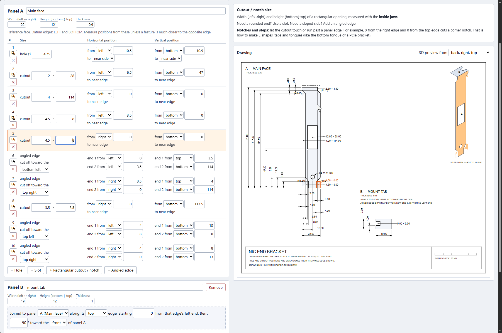
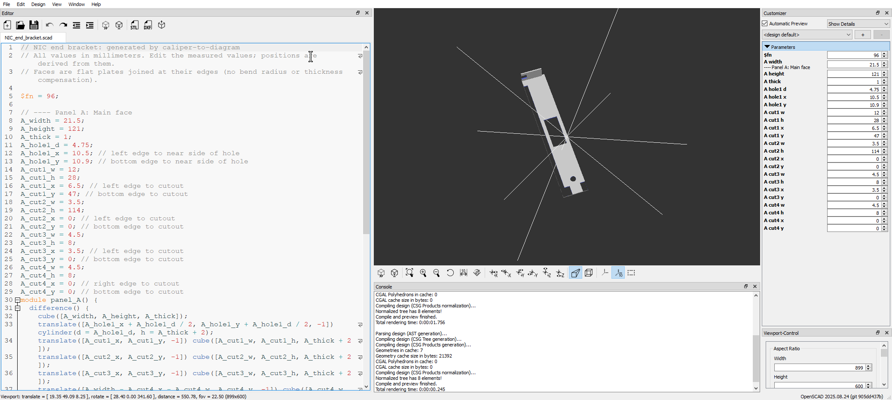

# caliper-to-diagram

Get an accurate and precise diagram of an object with only a pair of digital calipers. 

Perfect for people like me that don't understand CAD and refuse to learn it. There is no need to deal
with a confusing interface and all of the mental models that come with the CAD workflow when
you can create a 2D and 3D model by deriving the entire layout from a few measurements.



*NIC end bracket.*

## Running

```
uv run main.py            # serves the app on http://127.0.0.1:8765 and opens a browser
uv run main.py --port 0   # pick any free port
```

The app is plain HTML/JavaScript in `web/` with no dependencies. You can also open `web/index.html`
directly from disk. Your work autosaves in the browser; use **Save** to keep a `.json` file.

## How a part is described

- **Panels.**
- **Holes.** 
- **Rectangular cutouts.**
- **Slots.**
- **Angled edges.**
- **Joined faces.**

## Output formats

| Format | Use it for |
|---|---|
| **.json** (Save) |
| **SVG** / **Print 1:1** |
| **DXF** (R12) |
| **OpenSCAD** (.scad) |



## License

MIT.